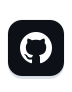
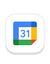

full-stack engineer in mumbai. my portfolio is a mac desktop where every project is a folder you can open and chat with.

## the folders

  
  
  
  
  
  

each card opens that folder on my site, where you can chat with the project.

## the toolbox

## lately

## say hi

  
  
  
  
  

got a rough idea? we'll figure out the rest together.

older projects

- **[Pavora](https://pavoracraft.vercel.app)**: 40+ copy-paste css and canvas backgrounds. [code](https://github.com/yashjaiswal2818/Pavora)
- **[YaadKar](https://yaadkar.vercel.app)**: face recognition for dementia care that speaks a family member's name in 7+ indian languages. [code](https://github.com/yashjaiswal2818/Yaadkar)
- **[AI Podcast Clipper](https://github.com/yashjaiswal2818/AIPodcastClipper)**: long podcasts in, 9:16 shorts out.
- **[Girls Walk Club](https://girlswalkclubsc.vercel.app)**: an events site built for a paying client.
- **[MentorAI](https://mentorai1.netlify.app)**: AI mentors with voice and talk-to-PDF. [code](https://github.com/yashjaiswal2818/mentorai)

