i'm a full-stack engineer in mumbai. mostly typescript and python: next.js, react, fastapi. i like owning a thing from the first sketch to the deployed app, then fixing whatever real users break.

my portfolio is a mac desktop where every project is a folder you can open and chat with. there's music, a few sticky notes and one konami code. it's at **[yashjaiswal-ten.vercel.app](https://yashjaiswal-ten.vercel.app)**.

### what's in the folders

- **[Stepwise](https://stepwise-beta.vercel.app)**: a DSA visualizer where every data structure is drawn as itself, with an AI tutor that can drive the playback. [code](https://github.com/yashjaiswal2818/stepwise)
- **[Bender](https://benderai.app)**: describe an app, get a set of real, themed mobile screens on an infinite canvas. edit them by chat, export clean code.
- **[get-ui](https://www.npmjs.com/package/get-ui-cli)**: one command to install any of 2,800+ react and tailwind components from nine open-source registries.
- **[ClauseWise](https://clausewise-nu.vercel.app)**: upload an indian loan or rental agreement and get every clause in plain language, with risk flags, in four languages. [code](https://github.com/yashjaiswal2818/clausewise)
- **Caliper**: an air-gapped agent for industrial documents. it computes deterministically, cites the exact region it used, and refuses when it can't. [code](https://github.com/yashjaiswal2818/sovereignAI)
- **[Rizzé Co.](https://rizze-plum.vercel.app)**: a custom headless storefront for a coastal activewear brand, on next.js 16 and shopify.

older projects

- **[Pavora](https://pavoracraft.vercel.app)**: 40+ copy-paste css and canvas backgrounds. [code](https://github.com/yashjaiswal2818/Pavora)
- **[YaadKar](https://yaadkar.vercel.app)**: face recognition for dementia care that speaks a family member's name in 7+ indian languages. [code](https://github.com/yashjaiswal2818/Yaadkar)
- **[AI Podcast Clipper](https://github.com/yashjaiswal2818/AIPodcastClipper)**: long podcasts in, 9:16 shorts out.
- **[Girls Walk Club](https://girlswalkclubsc.vercel.app)**: an events site built for a paying client.
- **[MentorAI](https://mentorai1.netlify.app)**: AI mentors with voice and talk-to-PDF. [code](https://github.com/yashjaiswal2818/mentorai)

### right now

building get-ui. learning rust and solana. open to freelance projects and full-time roles.

[portfolio](https://yashjaiswal-ten.vercel.app) · [linkedin](https://www.linkedin.com/in/yash-jaiswal-093684344) · [email](mailto:jaiswal.yash2803@gmail.com) · [15 min call](https://cal.com/yashjaiswal28/15min)
